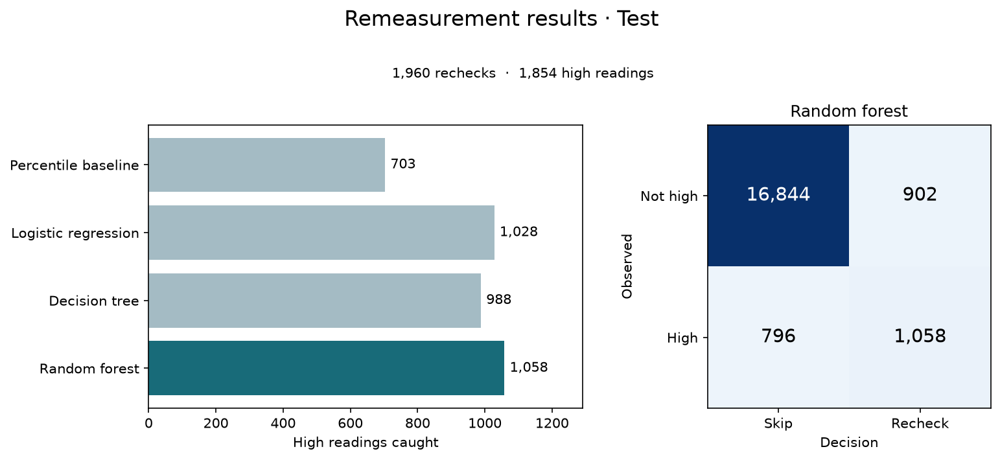
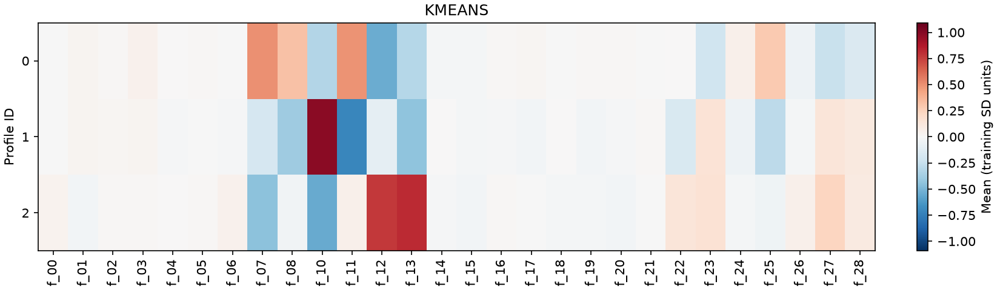
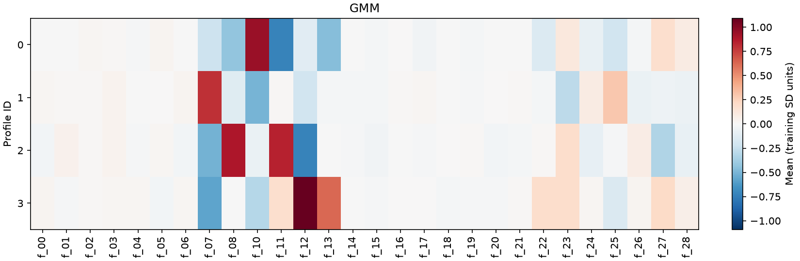
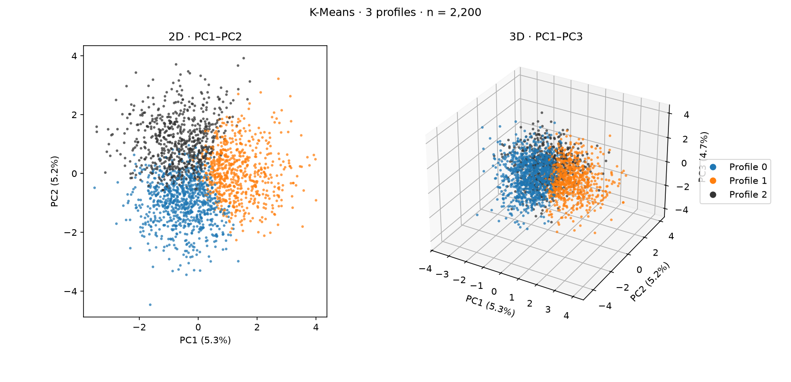
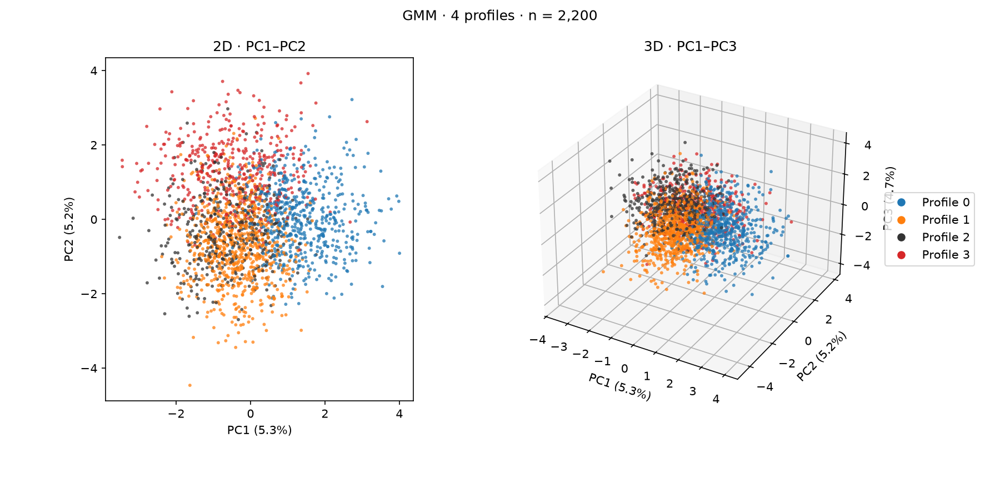
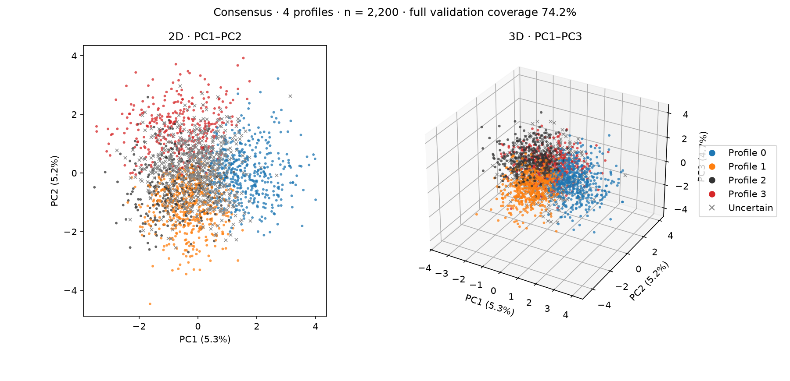

# Reconstructing high readings and describing operating profiles

## 1. Business understanding

**Prioritize repeat measurements.** If one reading is unavailable, which observations should an operator measure again first? This work provisionally defines a high reading as `f_09 > 16` and uses the other 28 measurements as inputs. During evaluation the recorded `f_09` supplies the answer; neither it, its derivatives, nor the row identifier may be used to predict it. The cutoff is the training-set 90th percentile, not an engineering safety limit.

Assume there is capacity to remeasure 10 out of every 100 observations. The decision criterion is the fraction of all high readings captured within those 10 slots (recall at a 10% review budget). A simple reference policy will prioritize low `f_08` values. Policies can be compared at equal capacity using `number of rechecks × cost per recheck + missed high readings × cost per miss`. Neither cost is observed, so no monetary savings are claimed.

**Identify operating profiles for monitoring.** The second goal is to find stable groups, describe their distinguishing measurements, and check whether their high-reading rates differ. Holding `f_09` out of clustering makes that comparison informative. A later experiment can assess whether one classifier reproduces agreement among several clustering methods on new observations, and at what computational cost. The actual control-state labels are unknown.

## 2. Data understanding

The [competition data](https://www.kaggle.com/competitions/tabular-playground-series-jul-2022/data) contain 98,000 simulated manufacturing observations with unique row IDs. `data.csv` contains the measurements; `sample_submission.csv` is an output template, so there is no second observation table to join. Of the 29 anonymous measurements, seven (`f_07`–`f_13`) take integer values and 22 are continuous. Their units and physical meanings are unspecified.

The analysis preserves the original exploratory split: permute the original row positions with NumPy `default_rng(42)`, then take 62,720 for training, 15,680 for validation, and 19,600 for the final test. All statistics and figures in this section use only the training rows. There are no missing training measurements or duplicate training measurement vectors. [Table 1: Attribute summary](tables/attribute_summary.csv) includes quartiles and counts beyond the 1.5-IQR fences. For example, 2,148 `f_09` readings fall outside those fences. They are retained: an extreme reading is precisely the kind of observation the predictive task is intended to capture.

**Figure 1.** The strongest pairwise linear association is between `f_08` and `f_09` (Pearson −0.361; Spearman −0.343). `f_09` also varies inversely with `f_12` (Pearson −0.297). [Table 2: Attribute relationships](tables/attribute_relationships.csv) lists both coefficients for all 406 distinct pairs.

**Figure 2.** Overall, 6,106 training rows (9.74%) have `f_09 > 16`. Among rows with `f_08 ≤ 4`, the rate rises to 21.97% (20,828 rows); among those with `f_08 ≥ 10`, it falls to 2.03% (15,453 rows). The ranges use the training quartiles of `f_08`; ties at integer cutoffs make group sizes unequal. This roughly elevenfold difference supports testing `f_08` as a baseline for prioritization. It does not establish causation or identify a machine fault.

## 3. Data preparation and reference rules

The observed target is 1 when `f_09 > 16` and 0 otherwise, including at 16. We retain the other 28 measurements as inputs, with `id` as a row key. No training value required imputation. [Table 3: Feature relevance](tables/feature_relevance.csv) gives each input's training-set Spearman correlation with the binary outcome. The strongest individual relationships are negative: `f_08` (−0.287), `f_13` (−0.261), and `f_11` (−0.229). Weak individual correlations do not rule out useful joint effects, so we do not discard inputs on this basis.

We compare two single-measurement rules (lowest `f_08` or lowest `f_12` first) with one derived score. For each measurement, its percentile is the fraction of training values less than or equal to the observed value. The combined score averages the two percentiles with equal weight. A low score gives priority to observations where both readings tend to be low. The training reference distribution stays fixed when scoring validation rows.

### Validation at a fixed review budget

Each rule selects exactly 1,568 of the 15,680 validation observations. Ties are resolved using a common seeded shuffle of sorted IDs (seed 42), independent of the outcome. Of the 1,526 high readings, `f_08` alone caught 469 (30.73% recall), `f_12` alone caught 225 (14.74%), and the combined score caught **567 (37.16%)**. Combining the measurements recovered **98 additional high readings** over `f_08` at the same cost in rechecks.

[Table 4: Baseline comparison](tables/baseline_comparison.csv) includes precision and lift. Of the rows selected by the combined rule, 36.16% were high readings, compared with 9.73% across validation: **3.72 times the expected yield of random selection**. The combined rule is the benchmark for subsequent classifiers. The final test set remains reserved for their evaluation.

## 4. Predictive modeling

We fit three classifiers to the 28 original input measurements. Logistic regression models an additive effect on the log-odds; we standardized its inputs using the mean and standard deviation fitted within each training fold. A decision tree can express thresholds and interactions without scaling. A random forest averages probabilities from 96 trees trained on bootstrap samples and considers a random subset of inputs at each split. The combined percentile score remains a separate reference rule.

We used three shuffled, stratified folds within the training set (seed 42). For logistic regression we tested inverse regularization strength `C` of 0.01, 0.1, and 1. For the tree we crossed maximum depths of 4 and 8 with minimum leaf sizes of 20 and 100. For the forest we crossed minimum leaf sizes of 5 and 25 with two feature-sampling settings: the square root of the input count or half of the inputs. We chose one setting per classifier by mean recall among the top 10% of each held-out fold, then refitted it on the full training set. [Table 5: Parameter search](tables/classifier_tuning.csv) gives the mean and standard deviation across folds for every setting.

For model selection we ranked validation rows by predicted probability of `f_09 > 16`, applying the same budget and tie-breaking policy as the baseline. The winner was fixed before scoring the final test set. [Table 6: Predictive comparison](tables/classifier_comparison.csv) records all methods on all three splits. Accuracy, sensitivity (recall), specificity, precision, lift, and confusion counts use the actual review decisions; ROC-AUC uses the full ranking. The training metrics are in-sample estimates.

## 5. Predictive evaluation

At 1,568 validation rechecks the forest caught 871 high readings, compared with 843 for logistic regression, 806 for the tree, and 567 for the baseline. The selected forest considered 14 of 28 inputs at each split and required at least 25 training observations per leaf.

On the test set, 1,854 of 19,600 readings were high. With 1,960 rechecks, the forest caught **1,058**, compared with **703** for the baseline: **355 additional high readings at the same review cost**. The forest missed 796 high readings and sent 902 non-high readings for remeasurement. Its sensitivity was 57.07%, specificity 94.92%, accuracy 91.34%, and ROC-AUC 0.901. Its lower sensitivity on test than on training (67.64%) shows why the training result alone would overstate the expected yield.

**Figure 3.** Test outcomes at the 10% review budget. The matrix separates observed readings (rows) from remeasurement decisions (columns).

## Descriptive modeling and evaluation: operating profiles

We standardized the 28 input measurements using training means and standard deviations. For each count from 2 to 10, we fitted K-Means (five initializations) and a full-covariance Gaussian mixture (GMM) on three training subsamples of 8,192 observations, using seeds 42–44. Each fit assigned the same 15,680 validation rows. Stability is the mean pairwise adjusted Rand index (ARI) across the three assignments; separation is the mean Euclidean silhouette on a fixed sample of 1,800 validation rows. Neither statistic requires control-state labels.

We required convergence and at least 1% of validation rows in each group across all three fits. Among counts within 0.05 of the best eligible stability, we selected the smallest count within 0.01 of the best remaining silhouette. [Table 7: Cluster-count comparison](tables/cluster_screen.csv) shows why K-Means selected **3 profiles**: four were slightly more stable (0.787 vs. 0.768), but three gave comparable separation. The GMM selected **4 profiles** (stability 0.575). Silhouettes were low for both selections (0.035 and 0.022): the profiles overlap. After refitting on all training rows, agreement between methods was ARI 0.345. For 6.85% of validation rows the two highest GMM membership probabilities differed by less than 0.10.

**Figure 4a–b.** Mean measurements in each validation profile, expressed in training standard deviations. Both heatmaps use the same color scale. Profile IDs are local to each method.

Only after selection did we inspect `f_09`. Both methods identified a profile with elevated `f_10` and low `f_11`: K-Means profile 1 had 1,044 high readings among 4,589 rows (22.75%); GMM profile 0 had 1,046 among 4,054 (25.80%). By contrast, GMM profile 3 showed elevated `f_12` and `f_13` and only 58 high readings among 3,374 (1.72%). [Table 8: Profile summaries](tables/cluster_profiles.csv) gives the counts and three most distinctive measurements for every group. The similar high-rate pattern is more interpretable than assuming that two arbitrary cluster IDs denote the same manufacturing state.

**Figure 5a–b.** Each figure shows the same 2,200 validation rows in two views. The left panel uses PC1 and PC2 (10.49% of training variance); the right adds PC3 (15.17% together). Colors identify the same profile within each pair of panels. Most variation lies outside both projections.

## Consensus profiles and the cost of approximating them

We paired the four-component GMM with a four-cluster K-Means voter: four clusters had comparable stability to the original three-cluster solution. The [training overlap table](tables/consensus_overlap.csv) gives the one-to-one match that maximizes shared memberships. Before validation we fixed the mapping from K-Means IDs 0, 1, 2, 3 to GMM IDs 1, 2, 3, 0. Equal votes yield a profile only when the voters agree; otherwise the outcome is *uncertain*. Both voters and the surrogate used the same 28 inputs, excluding `f_09`.

The voters agreed on 11,628 of 15,680 validation rows (74.16%) and 14,293 of 19,600 test rows (72.92%). [Coverage by profile](tables/consensus_coverage.csv) shows that agreement was uneven: on test it ranged from 62.50% for rows assigned GMM profile 1 to 83.62% for GMM profile 2. These are measures of agreement between methods; true operating-state labels are unavailable.

**Figure 6.** The validation sample from Figure 5. Colors follow the GMM IDs, and gray crosses mark disagreements. The title reports coverage on the full validation set.

We trained a decision tree on all five training vote outcomes, including uncertain. [Validation macro-F1](tables/surrogate_tuning.csv), giving each outcome equal weight, selected a maximum depth of 12 and at least 20 rows per leaf. On test, the tree reproduced 74.09% of the ensemble decisions (macro-F1 0.756); aligned K-Means alone reproduced 72.92% (macro-F1 0.671). K-Means always assigned a profile. The tree recognized 59.07% of the disputed cases, assigning a profile to the remaining 40.93%. See the [fidelity measures](tables/surrogate_fidelity.csv) and [five-outcome confusion matrices](tables/surrogate_confusion.csv) (rows: ensemble, columns: prediction).

In a [single-thread benchmark](tables/consensus_timing.csv) on the same 19,600-row batch, median inference took 12.92 ms for the ensemble, 2.30 ms for aligned K-Means, and 2.36 ms for the tree (one warm-up, nine timed runs, required preprocessing included). The tree was about 5.5 times faster than the ensemble on this machine. Saving about 11 ms per batch does not justify replacing the ensemble for this work: the tree too often gives a definite profile where the voters disagree.
