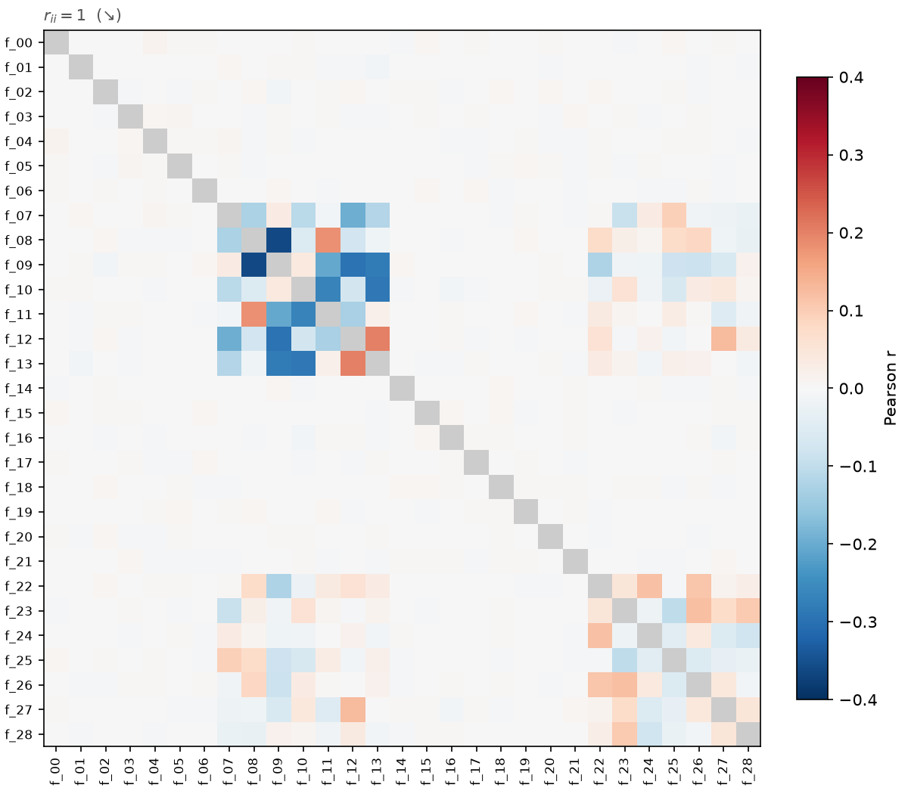
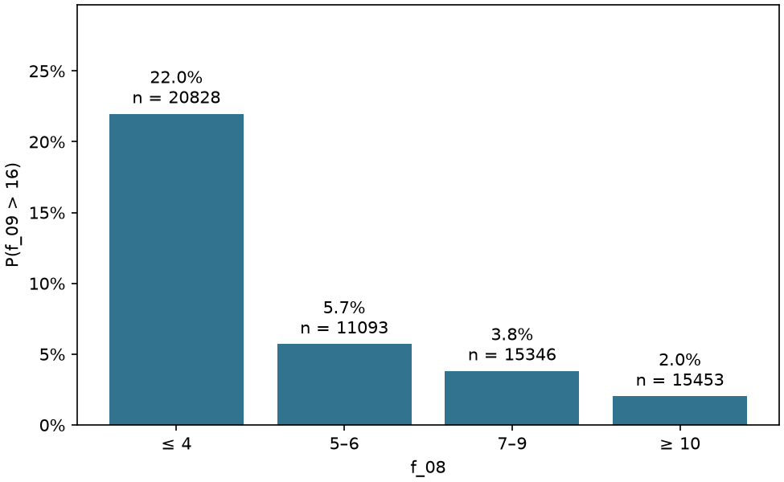

# Reconstructing high readings and describing operating profiles

## 1. Business understanding

**Prioritize repeat measurements.** If one reading is unavailable, which observations should an operator measure again first? This work provisionally defines a high reading as `f_09 > 16` and uses the other 28 measurements as inputs. During evaluation the recorded `f_09` supplies the answer; neither it, its derivatives, nor the row identifier may be used to predict it. The cutoff is the training-set 90th percentile, not an engineering safety limit.

Assume there is capacity to remeasure 10 out of every 100 observations. The decision criterion is the fraction of all high readings captured within those 10 slots (recall at a 10% review budget). A simple reference policy will prioritize low `f_08` values. Policies can be compared at equal capacity using `number of rechecks × cost per recheck + missed high readings × cost per miss`. Neither cost is observed, so no monetary savings are claimed.

**Identify operating profiles for monitoring.** The second goal is to find stable groups, describe their distinguishing measurements, and check whether their high-reading rates differ. Holding `f_09` out of clustering makes that comparison informative. A later experiment can assess whether one classifier reproduces agreement among several clustering methods on new observations, and at what computational cost. The actual control-state labels are unknown.

## 2. Data understanding

The [competition data](https://www.kaggle.com/competitions/tabular-playground-series-jul-2022/data) contain 98,000 simulated manufacturing observations with unique row IDs. `data.csv` contains the measurements; `sample_submission.csv` is an output template, so there is no second observation table to join. Of the 29 anonymous measurements, seven (`f_07`–`f_13`) take integer values and 22 are continuous. Their units and physical meanings are unspecified.

The analysis preserves the original exploratory split: permute the original row positions with NumPy `default_rng(42)`, then take 62,720 for training, 15,680 for validation, and 19,600 for the final test. All statistics and figures in this section use only the training rows. There are no missing training measurements or duplicate training measurement vectors. [Table 1: Attribute summary](tables/attribute_summary.csv) includes quartiles and counts beyond the 1.5-IQR fences. For example, 2,148 `f_09` readings fall outside those fences. They are retained: an extreme reading is precisely the kind of observation the predictive task is intended to capture.

**Figure 1.** The strongest pairwise linear association is between `f_08` and `f_09` (Pearson −0.361; Spearman −0.343). `f_09` also varies inversely with `f_12` (Pearson −0.297). [Table 2: Attribute relationships](tables/attribute_relationships.csv) lists both coefficients for all 406 distinct pairs.

**Figure 2.** Overall, 6,106 training rows (9.74%) have `f_09 > 16`. Among rows with `f_08 ≤ 4`, the rate rises to 21.97% (20,828 rows); among those with `f_08 ≥ 10`, it falls to 2.03% (15,453 rows). The ranges use the training quartiles of `f_08`; ties at integer cutoffs make group sizes unequal. This roughly elevenfold difference supports testing `f_08` as a baseline for prioritization. It does not establish causation or identify a machine fault.

## 3. Data preparation and reference rules

The observed target is 1 when `f_09 > 16` and 0 otherwise, including at 16. We retain the other 28 measurements as inputs, with `id` as a row key. No training value required imputation. [Table 3: Feature relevance](tables/feature_relevance.csv) gives each input's training-set Spearman correlation with the binary outcome. The strongest individual relationships are negative: `f_08` (−0.287), `f_13` (−0.261), and `f_11` (−0.229). Weak individual correlations do not rule out useful joint effects, so we do not discard inputs on this basis.

We compare two single-measurement rules (lowest `f_08` or lowest `f_12` first) with one derived score. For each measurement, its percentile is the fraction of training values less than or equal to the observed value. The combined score averages the two percentiles with equal weight. A low score gives priority to observations where both readings tend to be low. The training reference distribution stays fixed when scoring validation rows.

### Validation at a fixed review budget

Each rule selects exactly 1,568 of the 15,680 validation observations. Ties are resolved using a common seeded shuffle of sorted IDs (seed 42), independent of the outcome. Of the 1,526 high readings, `f_08` alone caught 469 (30.73% recall), `f_12` alone caught 225 (14.74%), and the combined score caught **567 (37.16%)**. Combining the measurements recovered **98 additional high readings** over `f_08` at the same cost in rechecks.

[Table 4: Baseline comparison](tables/baseline_comparison.csv) includes precision and lift. Of the rows selected by the combined rule, 36.16% were high readings, compared with 9.73% across validation: **3.72 times the expected yield of random selection**. The combined rule is the benchmark for subsequent classifiers. The final test set remains reserved for their evaluation.
