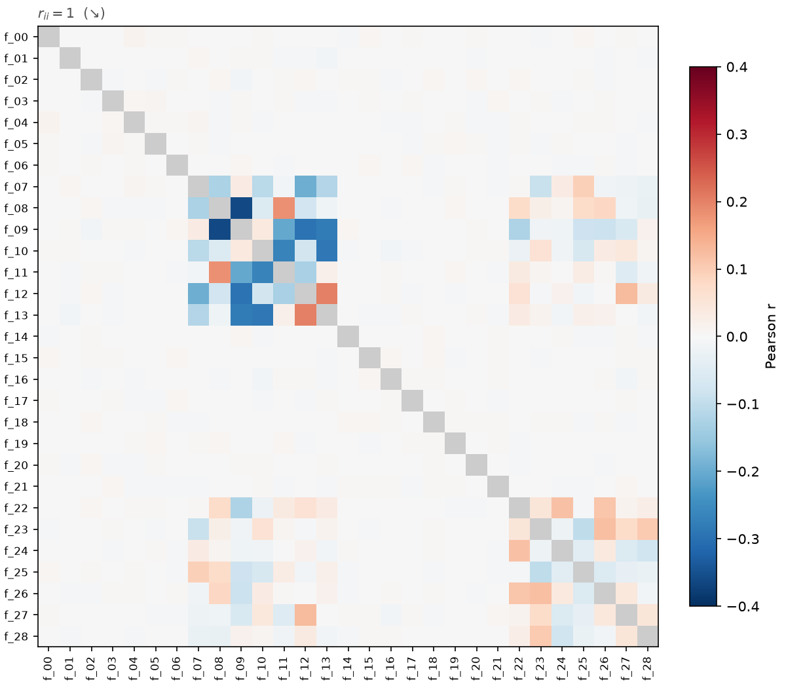
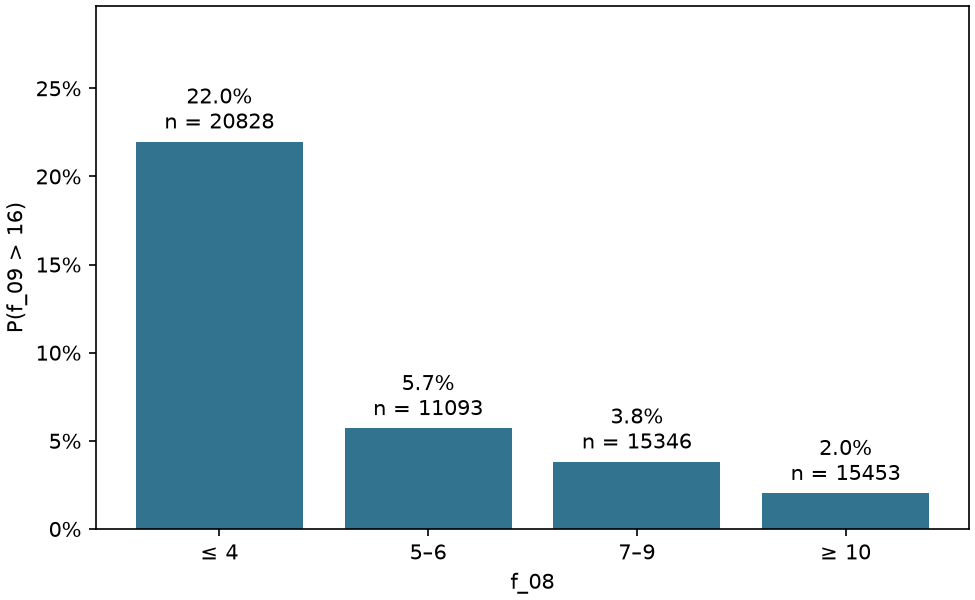

# Rekonštrukcia vysokých hodnôt merania a opis prevádzkových profilov

## 1. Pochopenie problému a cieľa

**Určenie priority opakovaných meraní.** Ak jedna nameraná hodnota nie je k dispozícii, ktoré pozorovania má obsluha premerať ako prvé? Táto práca predbežne definuje vysokú hodnotu podmienkou `f_09 > 16` a ako vstupy používa zvyšných 28 meraní. Pri vyhodnotení poskytuje zaznamenaná hodnota `f_09` správnu odpoveď; na jej predikciu sa nesmie použiť ani samotný atribút, ani atribúty z neho odvodené, ani identifikátor riadka. Hranica je 90. percentil trénovacej množiny, nie technický bezpečnostný limit.

Predpokladáme, že možno opätovne premerať 10 zo 100 pozorovaní. Kritériom je podiel všetkých vysokých hodnôt, ktoré sa podarí zachytiť výberom týchto 10 pozorovaní (senzitivita pri 10 % kapacite na premeranie). Jednoduchý referenčný postup uprednostní nízke hodnoty `f_08`. Postupy možno pri rovnakej kapacite porovnať pomocou vzťahu `počet premeraní × cena premerania + počet nezachytených vysokých hodnôt × náklady na jeden nezachytený prípad`. Ani jeden jednotkový náklad nepoznáme, preto neuvádzame finančné úspory.

**Identifikácia prevádzkových profilov na účely monitorovania.** Druhým cieľom je nájsť stabilné skupiny, opísať merania, ktorými sa odlišujú, a posúdiť, či sa medzi nimi líši podiel vysokých hodnôt. Preto `f_09` pri tvorbe zhlukov nepoužijeme. Neskorším experimentom možno overiť, do akej miery jeden klasifikátor na nových pozorovaniach reprodukuje konsenzus viacerých zhlukovacích metód a aké sú jeho výpočtové náklady. Skutočné označenia riadiacich stavov nepoznáme.

## 2. Pochopenie dát

[Súťažné dáta](https://www.kaggle.com/competitions/tabular-playground-series-jul-2022/data) obsahujú 98 000 simulovaných výrobných pozorovaní s jedinečnými identifikátormi riadkov. Merania sú v súbore `data.csv`; `sample_submission.csv` je šablóna výstupu, nie ďalšia tabuľka pozorovaní na spojenie. Z 29 anonymných meraní sedem (`f_07`–`f_13`) nadobúda celočíselné hodnoty a 22 je spojitých. Ich jednotky ani fyzikálny význam nie sú uvedené.

Analýza zachováva pôvodné prieskumné rozdelenie: pozície riadkov v pôvodnom poradí sa premiešajú generátorom NumPy `default_rng(42)`. Prvých 62 720 riadkov tvorí trénovaciu množinu, ďalších 15 680 validačnú a zvyšných 19 600 záverečnú testovaciu množinu. Všetky nasledujúce štatistiky a grafy vychádzajú len z trénovacích riadkov. V trénovacej množine nechýbajú namerané hodnoty a žiadne dva riadky nemajú zhodné hodnoty všetkých meraní. [Tabuľka 1: Súhrn atribútov](tables/attribute_summary.csv) uvádza kvartily aj počty hodnôt mimo hraníc určených 1,5-násobkom medzikvartilového rozpätia. Pri `f_09` leží mimo týchto hraníc 2 148 hodnôt. Ponechávame ich: práve extrémne hodnoty má prediktívna úloha pomôcť zachytiť.

**Obrázok 1.** Najsilnejší párový lineárny vzťah je medzi `f_08` a `f_09` (Pearsonov koeficient −0,361; Spearmanov koeficient −0,343). Záporná korelácia je aj medzi `f_09` a `f_12` (Pearsonov koeficient −0,297). [Tabuľka 2: Vzťahy medzi atribútmi](tables/attribute_relationships.csv) uvádza oba koeficienty pre všetkých 406 rôznych dvojíc.

**Obrázok 2.** Podmienku `f_09 > 16` spĺňa 6 106 trénovacích riadkov (9,74 %). Pri `f_08 ≤ 4` tento podiel stúpa na 21,97 % (20 828 riadkov); pri `f_08 ≥ 10` klesá na 2,03 % (15 453 riadkov). Hranice intervalov vychádzajú z trénovacích kvartilov `f_08`; v dôsledku zhôd na celočíselných hraniciach majú skupiny rôznu veľkosť. Približne jedenásťnásobný rozdiel odôvodňuje otestovanie `f_08` ako referenčného pravidla na určenie priority premerania. Nedokazuje však príčinnú súvislosť ani neidentifikuje poruchu stroja.
